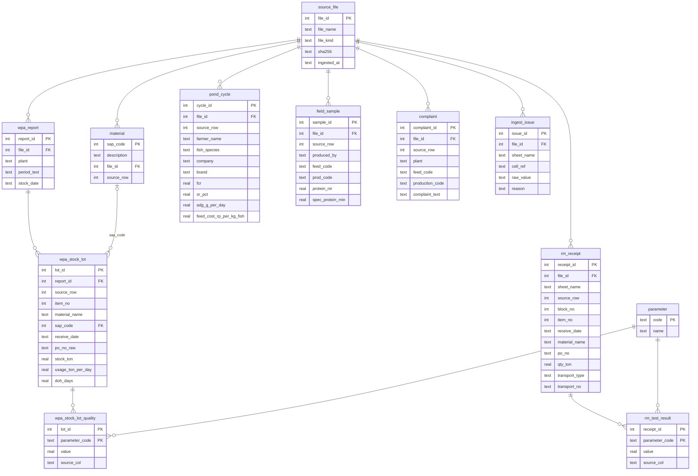

# Database Hermes AFT (SQLite)

Data mentah terstruktur dari dua jenis Excel CP Prima. Tahap ini hanya **memindahkan data apa adanya** ke database. Pembersihan (kode pakan, merek campuran, produk sendiri vs pesaing) dilakukan di tahap berikutnya.

| File              | Isi                                                                         |
| ----------------- | --------------------------------------------------------------------------- |
| `schema.sql`    | DDL semua tabel                                                             |
| `sheet_spec.py` | Peta sheet/kolom Excel → tabel/kolom DB (posisi header, teks header, tipe) |
| `extract.py`    | Baca Excel → record + asal sel                                             |
| `ingest.py`     | Buat ulang`aft.sqlite` lalu isi                                           |
| `validate.py`   | Cek isi DB vs Excel sel per sel (independen dari`extract.py`)             |

```bash
python3 source/database/ingest.py   --input docs_revised --db source/database/aft.sqlite
python3 source/database/validate.py --input docs_revised --db source/database/aft.sqlite
```

## ERD



Kolom lengkap ada di `schema.sql`.

## Tabel dan sumbernya

| Tabel                     | Sumber Excel                                                     | 1 baris =                                                                                                                                                                                                                         |
| ------------------------- | ---------------------------------------------------------------- | --------------------------------------------------------------------------------------------------------------------------------------------------------------------------------------------------------------------------------- |
| `material`              | WPA REPORT kolom BA–BB (lookup VLOOKUP kolom Raw Material Name) | 1 kode SAP unik                                                                                                                                                                                                                   |
| `wpa_report`            | WPA REPORT baris 1–5                                            | 1 laporan mingguan                                                                                                                                                                                                                |
| `wpa_stock_lot`         | WPA REPORT baris 8+, kolom A–K dan AP                           | 1 baris lot. Satu bahan bisa punya beberapa lot;`item_no` hanya terisi di baris pertama bahan                                                                                                                                   |
| `wpa_stock_lot_quality` | WPA REPORT kolom L–AO (30 parameter)                            | 1 nilai uji per lot                                                                                                                                                                                                               |
| `rm_receipt`            | sheet SBM, PBPM, MBM, FML C                                      | 1 truk/kontainer.`block_no` naik setiap ada baris kosong pemisah (MBM punya 2 blok dengan grade beda)                                                                                                                           |
| `rm_test_result`        | kolom uji G–N di sheet yang sama                                | 1 nilai uji per kiriman                                                                                                                                                                                                           |
| `parameter`             | kamus di`sheet_spec.py`                                        | 1 parameter uji. Header beda tapi artinya sama disatukan:`M`/`Moisture` → moisture, `CP`/`Cp` → crude_protein, `Ash`/`T.Ash` → ash, `INDEX`/`Index for MBM` → mbm_index, `PD`/`PD_02PCN` → pepsin_digest |
| `pond_cycle`            | Database Performance (header baris 3)                            | 1 siklus budidaya di 1 kolam                                                                                                                                                                                                      |
| `field_sample`          | Database Proximate (header baris 5)                              | 1 sampel pakan lapangan                                                                                                                                                                                                           |
| `complaint`             | Rekap Complain (header baris 1)                                  | 1 keluhan                                                                                                                                                                                                                         |
| `ingest_issue`          | –                                                               | 1 sel yang gagal dikonversi ke tipe kolomnya                                                                                                                                                                                      |

Tidak di-ingest: Stat_Complain, Pivot/N_ (rekap yang bisa dihitung ulang), foto keluhan (gambar), dan baris catatan singkatan di bawah daftar kode SAP.

## Aturan konversi

- Nilai rumus diambil dari hasil hitungan yang tersimpan di Excel (contoh: kolom Raw Material Name yang berisi VLOOKUP).
- Tanggal → teks ISO `YYYY-MM-DD`.
- Teks → spasi di awal/akhir dibuang. Angka di kolom kode (PO, kode produksi) → teks tanpa `.0` (`111223135.0` → `111223135`).
- Angka disimpan tanpa pembulatan.
- Sel kosong → NULL. Di tabel nilai uji, sel kosong tidak disimpan.
- Sel yang gagal dikonversi → NULL dan dicatat di `ingest_issue`, jadi tidak ada data yang hilang diam-diam.
- Kode SAP duplikat di daftar BA–BB disimpan sekali. Kalau deskripsinya berbeda, dicatat di `ingest_issue`.

## Validasi

`validate.py` membaca ulang Excel dan memeriksa:

1. Teks header sama dengan `sheet_spec.py` (tidak ada kolom tergeser)
2. Jumlah baris data Excel = jumlah baris DB
3. Setiap sel Excel = nilai DB, dan setiap nilai DB punya sel asal
4. Tidak ada sel terisi di kolom yang tidak ter-mapping
5. Tidak ada sheet tak dikenal dan tidak ada `ingest_issue`

Exit code 1 kalau ada temuan.

## Catatan untuk tahap berikutnya

- `rm_receipt` belum punya kode SAP. Nama bahan di sheet detail tidak selalu sama dengan daftar SAP (contoh "SBM BZ (I/L)"), dan 15 deskripsi SAP sama untuk kode berbeda. Mapping perlu dikonfirmasi QC.
- `po_no_raw` bisa berisi beberapa PO dalam satu sel. Perlu dipecah kalau mau ditautkan ke `rm_receipt.po_no`.
- `PD` di sheet FML C diasumsikan pepsin digest. Perlu konfirmasi.
- Kode pakan dan merek di `pond_cycle`, `field_sample`, dan `complaint` masih mentah (contoh `788-3.`, `783-3+788-3`).
